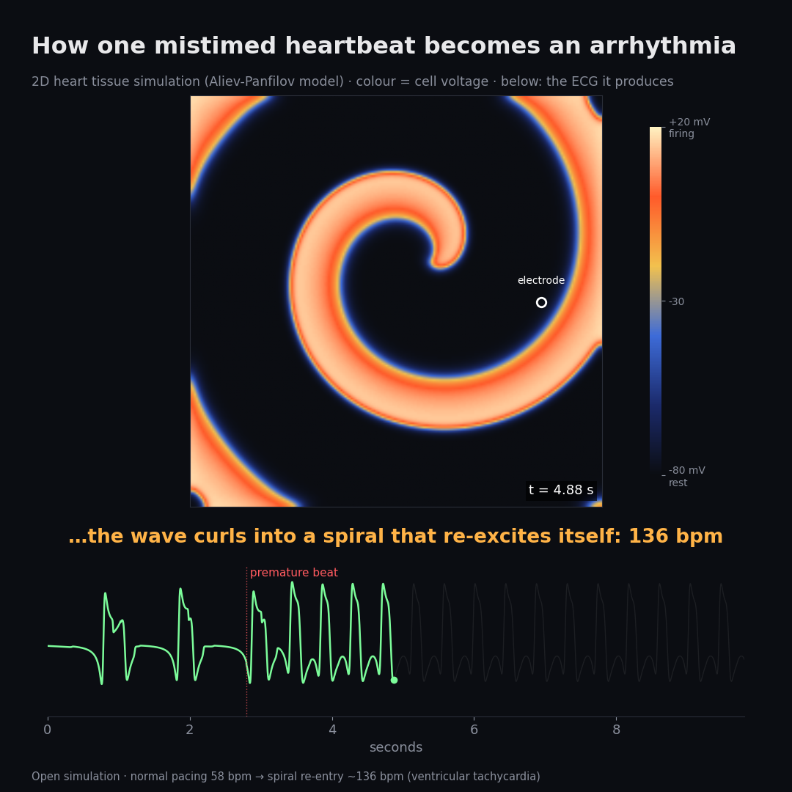
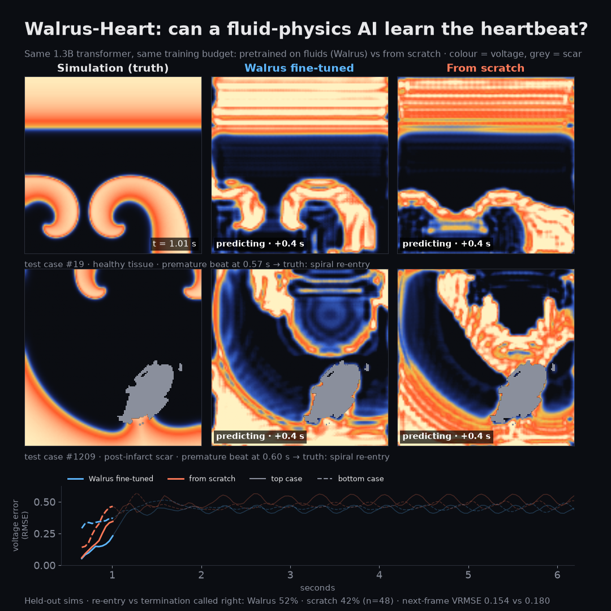

# Heart waves

**A physics foundation model meets the heart.** From first principles: simulate the electrical waves of heart tissue,
publish them as an open dataset, fine-tune the [Walrus](https://huggingface.co/polymathic-ai/walrus) physics model on them,
look at the physics with your own eyes, and try to tame an arrhythmia.

| | |
|---|---|
| ▶ **Play with it** | [huggingface.co/spaces/edgarmoreau/heart-waves](https://huggingface.co/spaces/edgarmoreau/heart-waves) (runs in the browser, no install) |
| 📦 **Dataset** | [edgarmoreau/cardiac-ep-2d](https://huggingface.co/datasets/edgarmoreau/cardiac-ep-2d): 2,000 simulations, The Well format, CC BY 4.0 |
| 🧠 **Model** | [edgarmoreau/walrus-heart](https://huggingface.co/edgarmoreau/walrus-heart): Walrus 1.3B fine-tuned + from-scratch baseline |



## Why

Most models on the Hugging Face hub read text or look at images. Very few learn **physics**, and when this project started
there was no cardiac simulation data on the hub at all (only real ECG recordings such as PTB-XL). The heart is a beautiful
test case: its electricity does not flow like current in a wire, it travels like a **wave in an excitable medium**. Every cell
is a battery (ion pumps keep it at about −85 mV) that fires when a neighbour pushes it over a threshold, then has to recharge
before it can fire again. That simple rule makes waves, and when a wave front breaks, **spirals**: the re-entry that drives
ventricular tachycardia and fibrillation.

## What we did

### 1. Found a physics model
`sim.py`: the Aliev–Panfilov monodomain model (Aliev & Panfilov, 1996), in 80 lines of numpy.

```
∂u/∂t = D∇²u − k·u(u−a)(u−1) − u·v                  u = voltage (V ≈ 100u − 80 mV)
∂v/∂t = (ε₀ + μ₁v/(u+μ₂))·(−v − k·u(u−a−1))         v = recovery ("battery recharging")
```

An S1 plane wave from the left, then a premature S2 beat in the **vulnerable window** (50–65 time units after the wave,
≈ 650–840 ms), breaks the front into a spiral that spins at ≈ 136 bpm. 1 time unit ≈ 12.9 ms. `render.py` makes the video in `media/`.

### 2. Built an open dataset: [edgarmoreau/cardiac-ep-2d](https://huggingface.co/datasets/edgarmoreau/cardiac-ep-2d)
`gen.py` batches the same physics in PyTorch on one GPU (~15 min on an A10G for 2,000 runs):

- 128 × 128 sheet, 161 frames (≈ 6.2 s of heart time), fields `voltage`, `recovery`, `conductivity`
- healthy / diffuse fibrosis / post-infarct scar tissue, 5 pacing sites, 1–3 beats, an S2 premature beat in 80 % of runs
- 3 pseudo-ECG leads per run, labels `sustained_reentry` and `reentry_rate_bpm`
- 43 % of runs end in sustained re-entry; the vulnerable window peaks at 774–903 ms (86 % re-entry); median re-entry rate 152 bpm

Stored in [The Well](https://github.com/PolymathicAI/the_well) HDF5 format, so physics foundation models can use it directly.
`stats_job.py` recomputes normalisation stats in float64 (an fp16 sum overflowed the first time).

### 3. Fine-tuned Walrus: [edgarmoreau/walrus-heart](https://huggingface.co/edgarmoreau/walrus-heart)
`walrus/walrus_heart.py` fine-tunes [polymathic-ai/walrus](https://huggingface.co/polymathic-ai/walrus) (1.3 B parameters, pretrained on
The Well, including Gray–Scott reaction-diffusion) and trains the **same architecture from scratch** as a control.
1,200 steps, batch 2, lr 1e-4, one A100 per run (~1.6 h each, ~5.4 A100-hours in total), run with `hf jobs`.

Test set, predicting the next frame (VRMSE, lower is better; 800 windows):

| model | voltage | recovery | mean |
|---|---|---|---|
| repeat last frame (persistence) | 0.592 | 0.535 | 0.563 |
| same architecture, from scratch, 1,600 runs | **0.164** | 0.196 | 0.180 |
| **Walrus fine-tuned, 1,600 runs** | 0.181 | **0.126** | 0.154 |
| **Walrus fine-tuned, only 200 runs** | **0.163** | **0.127** | **0.145** |

- **Pretraining helps**: Walrus beats the from-scratch model, even with 8× less heart data. The gain is on the slow
  recovery variable, the "memory" of the tissue, not on the sharp voltage fronts.
- **Long rollouts are the open problem**: fed its own predictions, every model drifts into high-frequency stripes after
  10–20 steps (0.4–0.8 s). Asked "does the arrhythmia sustain itself after 6 s?", Walrus says yes almost every time
  (52 % accuracy, 24 TP / 23 FP / 1 TN), the scratch model 42 %. Fixing this (longer training, multi-step and noise training,
  physical clamping at rollout) is the obvious next step.



`walrus/render_walrus.py` renders the comparison video (truth | Walrus | scratch, healthy and scarred tissue). It needs the
`rollouts_video.npz` files from the model repo.

### 4. Saw the physics, and tried to tame an arrhythmia
`study/` is a self-contained browser playground (three.js, no build step, also the
[Space](https://huggingface.co/spaces/edgarmoreau/heart-waves)): the same model on a 160² sheet that you can poke.
Fire cells with the mouse, paint scars, break a wave into spirals, defibrillate, and listen to a virtual ECG.

It also implements **resonant feedback pacing** from
[Roshan & Majumder, *Termination of figure-of-eight reentry via resonant feedback pacing*, Frontiers in Network Physiology 2025](https://pmc.ncbi.nlm.nih.gov/articles/PMC12672457/):
a sensor listens at one spot, and each time a wave passes it, a weak pulse (66 % of the firing threshold) goes to the whole
tissue. Timed to the spiral's own rotation, these small pushes add up like pushes on a swing, and the spiral tips drift until
they cancel or leave through the edge. Checked with this model (`study/core.js`, tested in node):

| figure-8 re-entry (two counter-rotating spirals) | result |
|---|---|
| no pacing | still spinning after 46 s |
| feedback pacing, sensor at the centre or in any quadrant | terminated in 2–4.4 s |
| the same pulses on a fixed clock (untimed) | still spinning: **the timing is the medicine, not the energy** |
| a defibrillator-style shock (556 % of threshold) | terminated, with ~18× more energy |

A single spiral with the sensor at the centre is not killed: it orbits the sensor, as in the paper's Fig. 2C.

```
cd study && python3 -m http.server 8000     # then open http://localhost:8000
node study/test_core.mjs                     # physics checks: wave speed, vulnerable window, defibrillation
```

## Layout

```
sim.py, render.py           numpy reference simulation + video
gen.py, stats_job.py        dataset generation on GPU (hf jobs) + float64 stats
dataset_card.md             the dataset's README on the hub
walrus/walrus_heart.py      Walrus fine-tune / scratch training + evaluation (hf jobs, A100)
walrus/render_walrus.py     truth vs Walrus vs scratch video
walrus/results/*/metrics.json
study/                      interactive browser page (also the HF Space)
media/                      videos and stills
```

## Limitations

2D isotropic sheet, a phenomenological cell model, no fibre orientation, no torso, pseudo-ECGs rather than 12-lead body-surface ECGs.
A research and teaching project, **not for clinical use**.

## License

Code: MIT. Dataset: CC BY 4.0. Fine-tuned weights: MIT, derived from [polymathic-ai/walrus](https://huggingface.co/polymathic-ai/walrus) (MIT).
